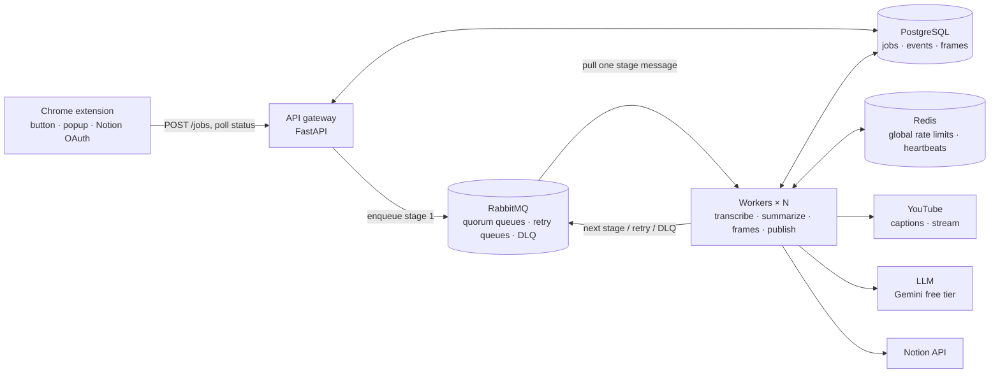

# Video Notes Agent: Project Overview

A one-read summary of what the assignment asks for, what we built, and how it holds up under failure.
The assignment text is [cloud_Note Taking agent.pdf](cloud_Note%20Taking%20agent.pdf). For setup and the
demo runbook see [README.md](README.md). For the full design see [PLAN.md](PLAN.md).

---

## 1. The problem

The Cloud course (Project 2) asks for a **distributed, asynchronous system that turns a YouTube video into
study notes in Notion**: summary text plus **real frames** of the important slides and diagrams, each with a
caption. The user drives it only from a **Chrome extension**. A queue-backed worker pool does the work and
must respect every external API's rate limit.

### Required pieces

Four separately running components, so one can be killed or scaled without touching the others:

| Component | Must do |
|---|---|
| Browser extension | Inject a **Take Notes** button on YouTube (it must keep working when you navigate between videos), run a one-time Notion OAuth, and show a popup with human-readable progress and a **View in Notion** link |
| API gateway | Accept jobs, expose status and results, **never run pipeline work** |
| Message broker | Durable queue, at-least-once delivery, redelivery when a worker crashes |
| Worker pool | 2 or more processes that pull and run jobs |

### Pipeline, states and API

- **Pipeline:** transcript → LLM synthesis (bullets, plus flagged timestamps with captions; chunk long
  transcripts and keep section order) → capture one frame per timestamp from the video stream → assemble and
  publish the Notion page.
- **States:** `QUEUED → TRANSCRIBING → SUMMARIZING → EXTRACTING_FRAMES → PUBLISHING → COMPLETED` or
  `COMPLETED_WITH_WARNINGS`. Any non-terminal state can end in `FAILED` (non-retryable) or `DEAD_LETTERED`
  (retries used up).
- **API:**
  - `POST /jobs` returns 202 immediately.
  - `GET /jobs/{id}` is read-only and returns 404 if the job is unknown.
  - `GET /jobs/{id}/results` returns 409 until the job is finished.
  - A health check, such as `GET /healthz`.

### Four failure modes the grader triggers live

1. **HTTP 429** from any of the three APIs (LLM, YouTube, Notion): back off and retry (for example 10 s, 30 s,
   90 s). The user sees the job waiting, not an error.
2. **Worker killed mid-job** (SIGKILL during frame extraction): another worker takes the job over. No job is
   lost and **no duplicate Notion page** appears.
3. **Some or all frames fail:** still publish the text with whatever frames worked, as
   `COMPLETED_WITH_WARNINGS`.
4. **A job that keeps failing** (for example a private video): after a bounded, configurable number of attempts
   it goes to a **dead-letter queue (DLQ)**.

### Hard constraints

- **A. Video length:** support videos up to 20 minutes, and reject longer ones deterministically.
- **B. Real frames only:** every image must be a real frame from the video, never generated or substituted.
  Each image needs an LLM-written caption saying what it shows and why it was flagged.

**Graded on:**
- Client experience.
- End-to-end latency for a video near 20 minutes.
- A burst of jobs draining with **zero LLM 429s**.
- Recovery after a killed worker.
- Constraints A and B, judged by an LLM.

We choose, and must justify, the broker, the state model, how the LLM rate limit is shared across workers,
the worker topology, the LLM provider, and the tooling.

---

## 2. What we built

The build: a Chrome extension, a FastAPI gateway, RabbitMQ, a pool of Python workers, PostgreSQL for job state
and Redis for shared rate limits. All of it runs from one `docker-compose.yml`.

| Component | Container | What it does |
|---|---|---|
| Extension | (Chrome, unpacked, no build) | Injects 📝 **Take Notes**, rejects videos over 20 min up front, runs the Notion OAuth once, shows progress in plain English |
| Gateway | `gateway` | Validates the URL, writes the job row, encrypts the Notion token into the message, enqueues it and returns 202. Serves status, results, `/healthz`, `/metrics`, admin DLQ and fault-injection endpoints |
| Broker | `rabbitmq` | One durable quorum queue per stage, TTL "retry" queues for backoff, and a DLQ |
| Workers | `worker` ×2 (scalable) | Each worker can run any stage. It pulls one message at a time, does the stage, saves the result, and hands off to the next stage |
| State | `postgres` | Job state machine, a per-job audit log of every transition and retry, and saved stage outputs (transcript, notes, frames) |
| Coordination | `redis` | LLM, YouTube and Notion rate limits shared by all workers, plus worker heartbeats |
| Optional | `prometheus`, `grafana`, `ollama` | Dashboards (queue depth, 429s, retries, latency), and a fully local LLM |

`PIPELINE_MODE=stub` replaces YouTube, LLM and Notion with fakes. You can then demo the whole distributed
system (queues, retries, crash recovery, DLQ) with no API keys. `PIPELINE_MODE=real` uses the real services.

---

## 3. Life of a job

1. **Click.** On a YouTube watch page, the content script reads the video ID and duration. It rejects videos over
   20 minutes on the spot and sends the job to the background service worker.
2. **Submit.** The background worker calls `POST /jobs` with the URL, the user's Notion token and an optional
   parent page. The gateway:
   - normalises the URL;
   - writes a `QUEUED` row to Postgres;
   - encrypts the token;
   - publishes a `transcribe` message (waiting for the broker's confirm);
   - returns **202** with a job ID. No pipeline work happens in the request.
3. **Transcribe.** A worker claims the job with an atomic compare-and-set (`QUEUED → TRANSCRIBING`). It fetches
   the title, the **true duration** (Constraint A again) and a timestamped transcript. It tries three sources in
   order:
   1. `youtube-transcript-api`;
   2. yt-dlp's caption tracks;
   3. if YouTube blocks captions, it downloads the audio and runs **Whisper locally** (`faster-whisper`, baked into
      the image).
4. **Summarize.** The transcript is split into chunks (~12k tokens, 15 s overlap). Each line is tagged with its
   time in **plain seconds** (`[430s]`), because small models misread `[07:10]` as 710. Each chunk gets one LLM
   call that returns structured JSON:
   - sections, with headings, time ranges and bullets;
   - **visual moments**, each with a timestamp, a predicted caption, the transcript evidence for flagging it, and
     an importance score.

   A repair step converts times the model still wrote as minutes-and-seconds digits, and clamps sections inside
   their chunk. A final call writes the whole-video TL;DR. Section order is preserved across chunks.
5. **Extract frames.** The worker:
   - picks up to 8 moments at least 20 s apart;
   - gets the video stream URL from yt-dlp;
   - grabs each frame with **ffmpeg seeking straight to the timestamp**.

   One batched **vision call** then judges the real images. It sees only each frame's timestamp and the
   transcript context, never the predicted caption, so it can't just copy it. It drops frames that are only a
   talking head, and writes each caption from what is visible in the frame. A frame that fails is recorded as a
   warning, never replaced.
6. **Publish.** The worker:
   - uploads the frames with Notion's File Upload API;
   - creates the page (title, TL;DR, sections, and images with captions linked to their timestamp);
   - marks the job `COMPLETED`, or `COMPLETED_WITH_WARNINGS` if any frame was omitted.
7. **Watch.** The popup polls `GET /jobs/{id}` and shows *Queued → Transcribing → … → Done*. It shows retry
   messages like *"AI service is busy, retrying in 10 s"*, and finally a **View in Notion** button.

**The rule in every stage:** the worker saves the stage's output to Postgres, then publishes the next stage's
message (confirmed by the broker), and **only then acks** the message it is working on. A crash at any point
leaves the message unacked, so RabbitMQ redelivers it.

---

## 4. How each failure mode is handled

| Failure | What happens | How to demo |
|---|---|---|
| **HTTP 429** (LLM, YouTube or Notion) | The stage is sent to a TTL "retry" queue with backoff 10 s → 30 s → 90 s (2/4/8 s in demo profile). 429s have their **own budget** (`RL_MAX_RETRIES=6`), so throttling never pushes a job to the DLQ. The popup shows "waiting, retrying in N s", never an error | `demo.py faults set llm_429=2` (or `notion_429`, `youtube_429`) |
| **Burst of jobs** | Prevented, not just retried. Before any LLM call a worker reserves capacity from a **Redis rate limiter shared by all workers**. The defaults are 12 requests/min, 200K tokens/min and 400/day, which is 80% of the Gemini 3.1 Flash Lite free tier (15 / 250K / 500), plus a cap on calls in flight. With no capacity, the stage is parked in a delay queue **without spending retry budget**, so the provider never returns a 429 | `demo.py burst <url1> <url2> …`, then watch Grafana's 429 panel stay at 0 |
| **Worker SIGKILL mid-job** | The worker's connection drops, so RabbitMQ requeues its unacked message right away and another worker picks it up (~1 s). Stages are **idempotent**: saved frames and chunks are skipped. The Notion page title carries a job marker, and a publish sub-state lets a retry **find and reuse the page** instead of creating a second one. `x-delivery-limit` stops a message that crashes workers in a loop | `demo.py crash <url>` kills the worker during frame extraction |
| **Frames fail** | Each failed timestamp becomes a warning (`FRAME_EXTRACTION_FAILED`, `FRAME_UPLOAD_FAILED`, `FRAME_NOT_RELEVANT`). The page is still published with the frames that worked, or text-only if none did, as `COMPLETED_WITH_WARNINGS` | `demo.py faults set frame_fail_rate=0.5` (or `1.0`) |
| **Job keeps failing** | Transient errors get `MAX_ATTEMPTS=5`: attempts 1–4 are retried with backoff, and the 5th failure goes through a dead-letter exchange to `jobs.dlq` as `DEAD_LETTERED`. Admin endpoints list and replay DLQ entries. Errors that can never succeed (video too long, no transcript obtainable) go straight to `FAILED`. A bad URL is rejected by the gateway with a 4xx and never becomes a job | `demo.py submit <url> --unavailable`, then `demo.py dlq` |

The gateway, broker and DB can also be restarted on their own. Workers keep going without the gateway, and
messages survive a RabbitMQ restart because the queues are durable quorum queues. Scale with
`docker compose up -d --scale worker=4`. Repeat the flag on every later `up`, otherwise it resets to 2 workers.

---

## 5. Key design decisions (and why)

| Decision | Why |
|---|---|
| **RabbitMQ quorum queues** (not Redis Streams or Kafka) | Per-message ack plus immediate redelivery when a connection drops is exactly the crash semantics required. Dead-letter exchanges and TTL queues give the DLQ and backoff with no plugins. `x-delivery-limit` catches crash loops |
| **One message per stage** (not one message per job) | A crash only re-runs the interrupted stage, not the whole job. It also makes the four states visible and lets stages scale independently (`WORKER_STAGES` can specialise a worker) |
| **Generalist workers, pull-based** (`basic.get`, later stages first) | Every worker can do every stage, so any worker can take over after a crash. Draining later stages first means started jobs finish before new ones begin, which keeps latency low under a burst |
| **Postgres state machine with compare-and-set transitions** plus a `job_events` audit log | A redelivered or duplicate message can't move a job backwards or run a stage twice. The audit log shows the grader every transition, retry, redelivery and which worker did it |
| **Ack only after a durable commit and a broker-confirmed next message** | This is the at-least-once guarantee the spec asks for. Combined with idempotent stages, it is effectively exactly-once |
| **Notion dedup by a title marker plus a publish sub-state** | Notion has no idempotency keys. If a worker dies right after Notion created the page, the retry finds that page and finishes it |
| **Global rate limiting in Redis** (atomic Lua sliding windows plus concurrency leases) | All workers share one budget, so scaling workers never multiplies LLM traffic. Parking instead of calling means 429s are avoided, not just survived |
| **Two separate retry budgets** (429s vs real errors) | Being throttled is not the job's fault. Only genuine failures should lead to the DLQ |
| **Free LLM by default** (Gemini free tier: `gemini-3.1-flash-lite`, fallback `gemini-3.5-flash-lite`) | No paid key needed. Providers are pluggable: Gemini, Ollama (fully local), any OpenAI-compatible API, OpenAI, or a mock. The fallback model is used only for overload, timeouts or an exhausted daily quota, never to dodge a per-minute 429 |
| **Plain-seconds timestamps plus a repair step** | Flash Lite wrote 7:10 as 710 seconds, which put frames in the wrong place. Seconds-only input plus automatic conversion of MM:SS digits fixes this without a bigger model |
| **Whisper fallback for transcripts** | YouTube often blocks caption downloads from servers (429 / "not a bot"). Local speech-to-text keeps real-mode jobs working anyway |
| **ffmpeg input-seek on the stream URL** | Pulls only the bytes around each timestamp instead of downloading the video, so frames are guaranteed real (Constraint B) |
| **Vision check that never sees the predicted caption** | The transcript only guesses what is on screen. Captioning from the pixels alone keeps the Notion caption honest about what the frame actually shows (Constraint B), and drops talking-head frames |
| **Notion token never stored** | The extension sends it with each job, it travels encrypted inside queue messages, and it is never written to the DB or logs. The OAuth client secret stays on the server; the extension only receives the resulting token |

---

## 6. Tech stack and repo map

**Stack:**
- **Backend:** Python 3.12, FastAPI, aio-pika (RabbitMQ 4), SQLAlchemy 2 async (PostgreSQL 16), Redis 7.
- **Media:** yt-dlp, youtube-transcript-api, faster-whisper, ffmpeg.
- **Notion:** Notion API (`2022-06-28`) and its File Upload API.
- **Extension:** Chrome Manifest V3, vanilla JS, no build step.
- **Ops:** Docker Compose, with optional Prometheus and Grafana. Images are multi-arch: Windows, Linux, Intel
  and Apple Silicon Macs.

| Path | What's there |
|---|---|
| [src/notetaker/gateway/](src/notetaker/gateway/) | FastAPI app: job routes, `/healthz`, Notion OAuth code exchange, admin (DLQ, faults, events) |
| [src/notetaker/common/](src/notetaker/common/) | Shared config, job states, error classes, DB models and repository (CAS transitions), RabbitMQ topology, encryption, fault injection |
| [src/notetaker/worker/runner.py](src/notetaker/worker/runner.py) | The worker loop: pull, claim, run stage, commit, publish next, ack; retry, backoff and DLQ routing |
| [src/notetaker/worker/ratelimit.py](src/notetaker/worker/ratelimit.py) | Redis Lua sliding-window limiter shared by all workers |
| [src/notetaker/worker/stages/](src/notetaker/worker/stages/) | `real.py` (the four real stages) and `stub.py` (fake stages for keyless demos) |
| [src/notetaker/worker/clients/](src/notetaker/worker/clients/) | YouTube (transcripts, Whisper fallback, stream URL), ffmpeg, Notion |
| [src/notetaker/worker/llm/](src/notetaker/worker/llm/) | LLM providers, fallback model, JSON repair |
| [src/notetaker/worker/pipeline/](src/notetaker/worker/pipeline/) | Prompts, transcript chunking, synthesis and merge (with timestamp repair), Notion block builder |
| [extension/](extension/) | Content script (button), background (OAuth, submit, polling), popup, options |
| [scripts/demo.py](scripts/demo.py) | One script for every demo: health, submit/watch, faults, crash, burst, DLQ (standard library only) |
| [observability/](observability/) | Prometheus config and the Grafana "Video Notes Pipeline" dashboard |
| [tests/](tests/) | 109 Python tests (unit, API contract, worker integration, real stages against fakes) and 7 extension tests |
| [docker-compose.yml](docker-compose.yml), [services/](services/) | The stack and the gateway and worker Dockerfiles |

---

## 7. Status

**Verified working:**

- **Tests:** all 109 Python tests and 7 extension tests pass.
- **Stub mode, end to end:**
  - normal completion;
  - SIGKILL crash recovery, with one Notion page;
  - 429 backoff;
  - DLQ routing;
  - a 12-job burst spread across workers;
  - the Grafana dashboard.
- **Real services:**
  - real Gemini synthesis plus the Whisper fallback on an 18:40 video;
  - real runs on a 16:23 video, which found and fixed the timestamp and caption-copying bugs;
  - real yt-dlp and ffmpeg frame capture;
  - Notion error handling.
- **Worker image:** builds on Windows/x86 and runs Whisper offline as a non-root user.
- **macOS:** every Python dependency has a prebuilt Linux arm64 wheel, so it should run on Apple Silicon.
  Ports are configurable for Homebrew clashes (README §1.1).

**Still to do:**

1. **Notion OAuth connection:** create it in the new developer portal and put the client ID and secret in
   `.env` (README §2.2).
2. **A full real run published to Notion** with `PIPELINE_MODE=real`, then rehearse the four failure demos with
   `RETRY_PROFILE=demo`.
3. **A first `docker compose up` on a real Mac.**

**How to run it:** [README.md](README.md) §1 (quick start, stub mode), §1.1 (macOS), §2 (real mode setup),
§4 (failure-demo runbook).
